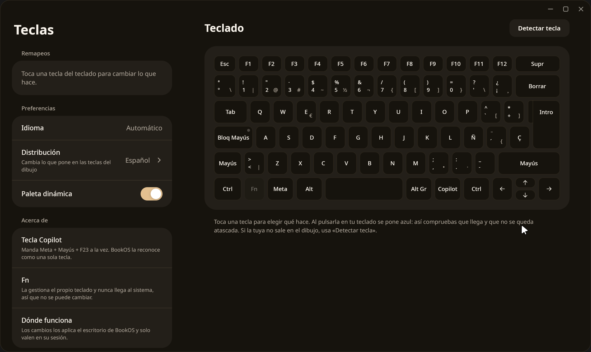

# Teclas · GPUI

Interfaz nativa de Remap para Linux Wayland, con el teclado ISO/ANSI, editor de
remapeos, comandos, detección de teclas y probador de pulsaciones. Conserva el
protocolo del compositor BookOS y de `bookos-teclasd`. La interfaz Tauri original
permanece en la raíz del repositorio.



## Obtener el código

El remoto de este repositorio es:

```sh
git clone https://github.com/bookos-os/remap.git
```

La estructura local debe conservar estos proyectos hermanos, como en el árbol
BookOS proporcionado:

```text
BookOS/
  remap/GPUI/
  plantilla-gpui/bookos-ui/
  fonts/vendor/gpui/
```

`bookos-ui` se usa por ruta. La adaptación del backend Linux está documentada en
[vendor/README.md](vendor/README.md); no modifica los proyectos hermanos.

## Requisitos

Se ha compilado con [Rust y Cargo](https://www.rust-lang.org/tools/install)
1.99.1. La edición 2024 requiere una herramienta compatible. Para comprobarlos:

```sh
rustc --version
cargo --version
pkg-config --modversion xkbcommon wayland-client fontconfig vulkan
```

Se necesitan las bibliotecas de desarrollo de libxkbcommon, Wayland, fontconfig
y Vulkan, además de `pkg-config` y un enlazador C. En ejecución: una sesión
Wayland con Vulkan y un bus D-Bus. Sin motor de remapeo se puede inspeccionar el
teclado y la app explica cómo habilitarlo; no simula cambios.

## Ejecutar en desarrollo

Desde `remap/GPUI`:

```sh
cargo run --locked
```

Es una aplicación de escritorio: no abre un servidor web. La ventana inicial
mide 1240×740 y admite un mínimo de 1080×620.

El idioma se decide automáticamente por `LC_ALL`, después `LC_MESSAGES` y
finalmente `LANG`. Los locales ingleses usan inglés; el resto usa castellano,
igual que el fallback original. No hay selector manual. Para verificar ambos:

```sh
LC_ALL=es_ES.UTF-8 cargo run --locked
LC_ALL=en_US.UTF-8 cargo run --locked
```

Las preferencias de distribución visual y paleta se guardan en
`$XDG_CONFIG_HOME/bookos-teclas/state.json`, o en
`~/.config/bookos-teclas/state.json`. Los remapeos siguen almacenándose donde
los gestiona el motor existente; no se duplican ni se migran a otro formato.
El selector de distribución cambia las leyendas del dibujo, no el teclado de
la sesión. El idioma es siempre automático.

## Compilar, probar y empaquetar

```sh
cargo build --release --locked
cargo test --locked
cargo clippy --locked --all-targets --features pruebas-ui -- -D warnings
cargo fmt --check
./tests/probar-bus.sh
```

La prueba ignorada por `cargo test` necesita el doble de D-Bus: el último script
la ejecuta dos veces, con cada motor, en buses privados. Requiere `dbus-run-session`
y Python del sistema con PyGObject/Gio. No captura dispositivos físicos ni cambia
los remapeos de la sesión. Los comandos `--offline` del script requieren la caché
de dependencias ya disponible.

Para las regresiones de ventana: compilar con `--features pruebas-ui`, iniciar
`tests/servicio_prueba.py` en un bus privado, dirigir `DBUS_SYSTEM_BUS_ADDRESS` al
mismo bus y establecer `REMAP_PRUEBA_BASE` y `BOOKOS_TECLAS_PRUEBAS` en un directorio
temporal. `tests/validar_ui.py` comprueba eventos, guardado, errores y navegación;
sus capturas requieren el portal de BookOS y Pillow. El control de pruebas no se
compila en el binario normal.

```sh
./empaquetar.sh
```

El script genera un RPM en `BookOS/Build/bookos-teclas/`, con la interfaz GPUI y
el servicio existente. También hay un [PKGBUILD](PKGBUILD) para Arch. No instala
el paquete. El servicio conserva sus políticas originales de D-Bus y polkit.

La evidencia y sus límites están en [replica/build-log.md](replica/build-log.md).
El formato del RPM y los scripts se validan aparte; eso no sustituye una prueba
de instalación en un sistema de destino.

## Contribuir

Los problemas se registran en el [repositorio de Remap](https://github.com/bookos-os/remap/issues).
Los cambios de esta migración se limitan a `GPUI/`. Antes de proponerlos, ejecutar
las comprobaciones anteriores y revisar visualmente los estados afectados.

Licencia: [LicenseRef-BookOS](LICENSE). Los dos crates adaptados conservan su
licencia Apache-2.0 y su procedencia.
